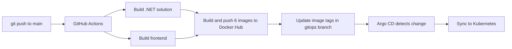

# Vega — Agricultural Pharmacy E-Commerce

Vega is a full-stack e-commerce platform for an agricultural pharmacy. The
backend is split into independently-deployable ASP.NET Core microservices and
the frontend is a React + TypeScript SPA.

The project's main goal is to demonstrate a complete CI/CD workflow: every push
to `main` is built, containerized, and rolled out to Kubernetes automatically
using GitHub Actions and Argo CD (GitOps). See [CI/CD](#cicd).

## Architecture

Each service owns its own PostgreSQL schema (`users`, `products`, `carts`,
`orders`) inside a shared `vega` database — services never read another
service's schema, only its HTTP API. Services communicate over HTTP.
The frontend talks to every service through REST; JWTs issued by the User
Service are attached to authenticated requests.

## Services

| Service  | Port | Folder                           |
| -------- | ---- | -------------------------------- |
| User     | 5001 | `services/Vega.UserService`      |
| Product  | 5002 | `services/Vega.ProductService`   |
| Cart     | 5003 | `services/Vega.CartService`      |
| Order    | 5004 | `services/Vega.OrderService`     |
| Payment  | 5005 | `services/Vega.PaymentService`   |
| Frontend | 5173 | `frontend/`                      |

## CI/CD

Delivery is fully automated and follows a GitOps model: GitHub Actions builds
and publishes the images, and Argo CD makes the cluster match what is in Git.



### Pipeline (`.github/workflows/ci.yml`)

Triggered on every push to `main`:

1. **`build-dotnet`**: restores and builds `Vega.sln` in Release mode (.NET 8).
2. **`build-frontend`**: `npm ci` and `npm run build` (Node 20, npm cache enabled).
3. **`build-and-push-images`** (runs only if both builds pass):
   - builds a Docker image for each of the five services and the frontend, with
     Buildx and the GitHub Actions layer cache;
   - pushes each one to Docker Hub as `vega-<name>:latest` and
     `vega-<name>:<commit-sha>`;
   - copies `k8s/` into the `gitops` branch, points every Deployment at the new
     `<commit-sha>` tag, and pushes the commit.

Each image is pinned to the exact commit that produced it, so every deployment
is traceable and a rollback is just a revert on the `gitops` branch.

Required repository secrets: `DOCKERHUB_USERNAME`, `DOCKERHUB_TOKEN`.

### Deployment (Argo CD)

`argocd/argocd-app.yaml` defines an Argo CD `Application` that watches the
`k8s/` directory of the `gitops` branch and syncs it to the `vega` namespace.
Automated sync is on, with `prune` (resources removed from Git are removed from
the cluster) and `selfHeal` (manual drift in the cluster is reverted).

To register it, with Argo CD installed in the cluster:

```
kubectl apply -f argocd/argocd-app.yaml
```

### Kubernetes layout (`k8s/`)

| File                                   | Purpose                                              |
| -------------------------------------- | ---------------------------------------------------- |
| `namespace.yaml`                       | The `vega` namespace                                 |
| `configmap.yaml`                       | Non-secret config shared by the services (JWT issuer/audience, service URLs) |
| `postgres.yaml`                        | Postgres StatefulSet with a persistent volume        |
| `*-service.yaml`, `frontend.yaml`      | A Deployment and ClusterIP Service per component     |
| `ingress.yaml`, `middleware.yaml`      | Traefik ingress for `vega.local` and path-prefix stripping |

The JWT key and DB password live in a `vega-secret` Secret that is not stored in
Git (see [Kubernetes secrets](#kubernetes-secrets)).

## Running locally

Create your local secrets file (it is gitignored) and fill in real values,
e.g. `openssl rand -hex 32`:

```
cp .env.example .env
```

Bring up Postgres (a single `vega` database; each service creates its own
schema on first migrate). Compose refuses to start without `JWT_KEY` and
`POSTGRES_PASSWORD` in `.env`:

```
docker compose up -d
```

Run each service in its own shell. The services read the JWT key and DB
password from the environment, so load them first (same shell, before
`dotnet run`):

```
set -a; source .env; set +a
export Jwt__Key="$JWT_KEY"
export ConnectionStrings__Default="Host=localhost;Port=5433;Database=vega;Username=vega;Password=$POSTGRES_PASSWORD"
dotnet run --project services/Vega.UserService
dotnet run --project services/Vega.ProductService
dotnet run --project services/Vega.CartService
dotnet run --project services/Vega.OrderService
dotnet run --project services/Vega.PaymentService
```

Frontend:

```
cd frontend
cp .env.example .env
npm install
npm run dev
```

Open http://localhost:5173.

### Notes

- The User Service signs JWTs that the other services validate, so they all
  share the `Jwt:Issuer/Audience/Key` config block. The key is never committed:
  locally it comes from `.env`, on Kubernetes from the `vega-secret` Secret.
- The Product Service seeds a small inventory on first boot so the storefront
  has something to render.
- The Payment Service is a sandbox: it sleeps for a moment and returns
  `Paid` for most orders, `Failed` for a small random slice plus any
  suspiciously round high-value order.

## Kubernetes secrets

`k8s/` deliberately has no Secret manifest. Create it once in the cluster
(never commit real values):

```
kubectl -n vega create secret generic vega-secret \
  --from-literal=jwt-key="$(openssl rand -hex 32)" \
  --from-literal=db-password="$(openssl rand -hex 16)"
```

## Tech

- ASP.NET Core 8 Web API, EF Core, PostgreSQL
- JWT bearer auth (`Microsoft.AspNetCore.Authentication.JwtBearer`)
- React 18 + TypeScript, React Router, Axios, Vite
- Docker, Kubernetes, Traefik, GitHub Actions, Argo CD (GitOps)
